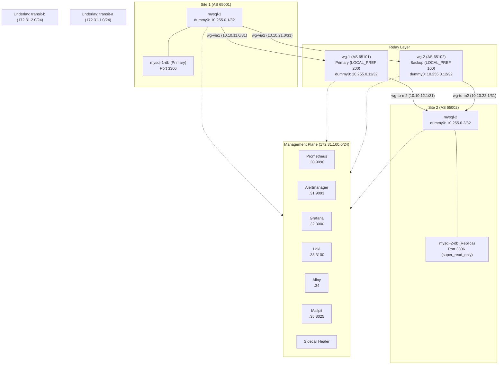

# sync-or-swim

A highly available network link and database replication topology between two MySQL sites across redundant WireGuard relays, built for the ArvanCloud SRE challenge.

The platform interconnects two simulated geographic database sites (`mysql-1` and `mysql-2`) across two independent WireGuard relays (`wg-1` primary, `wg-2` backup). Dynamic routing with eBGP and BFD automatically handles sub-second failover between relays. MySQL 8.4 GTID replication binds to stable loopback interfaces with source address rewriting; during manual failovers, the replication connection survived when the next hop changed. The entire infrastructure is deployed and configured declaratively using Ansible and Docker Compose.

---

## Requirements and Bonus Checklist

| Requirement / Item | Description | Status | Implementation Links |
|---|---|---|---|
| **Part 1: Network & Routing** | Redundant relays, dynamic failover, MTU & keepalives | Done | [roles/wireguard/](roles/wireguard/), [roles/frr/](roles/frr/), [docs/architecture.md](docs/architecture.md) |
| ↳ WireGuard server failure | Relay down; BFD detects and BGP fails over to surviving relay | Done | [tests/chaos/test_scenarios.py](tests/chaos/test_scenarios.py), [docs/results.md](docs/results.md) |
| ↳ Network path failure | Underlay transit path broken; BFD detects and route shifts | Done | [tests/chaos/test_scenarios.py](tests/chaos/test_scenarios.py), [docs/results.md](docs/results.md) |
| ↳ End-to-end connectivity loss | Both paths down; AllPathsDown alert fires and replication waits | Done | [tests/chaos/test_scenarios.py](tests/chaos/test_scenarios.py), [docs/results.md](docs/results.md), [docs/runbooks/AllPathsDown.md](docs/runbooks/AllPathsDown.md) |
| ↳ Path recovery after failure | Primary path restores; BGP re-establishes and traffic returns | Done | [tests/chaos/test_scenarios.py](tests/chaos/test_scenarios.py), [docs/results.md](docs/results.md) |
| **Part 2: MySQL HA** | MySQL 8.4 GTID replication between loopbacks, read-only replica | Done | [roles/mysql/](roles/mysql/), [docs/adr/0003-loopback-addressing-source-rewrite.md](docs/adr/0003-loopback-addressing-source-rewrite.md), [docs/adr/0005-no-automatic-db-promotion.md](docs/adr/0005-no-automatic-db-promotion.md) |
| **Part 3: Monitoring & Alerting** | Prometheus, Alertmanager, Grafana, exporters, runbooks | Done | [roles/monitoring/](roles/monitoring/), [roles/exporters/](roles/exporters/), [monitoring/prometheus/rules/alerts.yml](monitoring/prometheus/rules/alerts.yml), [docs/runbooks/](docs/runbooks/) |
| **Part 4: Logs & Troubleshooting** | Centralized logs with Loki/Alloy, netlink route-monitor, wg-watch | Done | [roles/logging/](roles/logging/), [docs/logging.md](docs/logging.md) |
| **Ansible-Only Deployment** | Fully automated single-command orchestration (`make up`) | Done | [playbooks/site.yml](playbooks/site.yml), [roles/lab_infra/](roles/lab_infra/) |
| **GitHub Delivery** | Complete Git history, CI workflows, and GHCR container releases | Done | [.github/workflows/ci.yml](.github/workflows/ci.yml), [.github/workflows/release.yml](.github/workflows/release.yml) |
| **Bonus 1: Sub-second Failover** | BFD timers 300 ms x 3 (0.21 s crash, 0.95 s pause detection) | Done | [inventory/docker/group_vars/all/network.yml](inventory/docker/group_vars/all/network.yml), [docs/adr/0004-bfd-timers-300x3.md](docs/adr/0004-bfd-timers-300x3.md) |
| **Bonus 2: Route Flap Prevention** | delayopen 30 s on the primary session + BGP dampening; under 30% loss the path changed once in 60 s instead of 15 times | Done | [roles/frr/templates/frr.conf.j2](roles/frr/templates/frr.conf.j2), [tests/integration/test_frr_flap.py](tests/integration/test_frr_flap.py) |
| **Bonus 3: ECMP Load Balancing** | Multipath relax, dual active next-hops toggle | Done | [roles/frr/templates/frr.conf.j2](roles/frr/templates/frr.conf.j2) (`routing_mode: ecmp`) |
| **Bonus 4: Routing Security** | TCP MD5 auth, GTSM (TTL 1), prefix lists, non-transit filtering, and a default-drop nftables firewall per node (WireGuard only from its peer, BGP/BFD only inside the tunnels, MySQL only from the peer loopback); tests attack from a stranger container | Done | [roles/frr/templates/frr.conf.j2](roles/frr/templates/frr.conf.j2), [roles/firewall/](roles/firewall/), [tests/integration/test_firewall.py](tests/integration/test_firewall.py) |
| **Bonus 5: Automated Failback** | BGP returns traffic to wg-1 automatically once it has been stable for 30 s (measured 32-41 s after recovery) | Done | [roles/frr/templates/frr.conf.j2](roles/frr/templates/frr.conf.j2), [docs/results.md](docs/results.md) |
| **Bonus 6: Automated Failure Tests** | Nine failure scenarios with measured switch and recovery times, and seven tests that fire every alert with a real fault and require it to clear | Done | [tests/chaos/test_scenarios.py](tests/chaos/test_scenarios.py), [docs/results.md](docs/results.md) |
| **Bonus 7: Automated Troubleshooting** | `scripts/diagnose.py` checks six layers bottom-up and names the likely root cause; critical alerts run it automatically and log the verdict to Loki | Done | [scripts/diagnose.py](scripts/diagnose.py), [roles/autodiagnose/](roles/autodiagnose/) |
| **Bonus 8: Integration Tests** | 193 pytest/testinfra integration tests; every test starts from a converged lab, the firewall is attacked from a stranger container, and the replication alerts are tested end to end | Done | [tests/integration/](tests/integration/) |
| **Bonus 9: Root Cause Postmortems** | Five postmortems of real incidents, plus the problem log in docs/notes.md | Done | [docs/postmortems/](docs/postmortems/) |

---

## Topology



---

## Addressing and ASN Table

| Node | ASN | Loopback (`dummy0`) | Transit-A (`ul-a`) | Transit-B (`ul-b`) | Management (`mgmt0`) | WireGuard Tunnels |
|---|---|---|---|---|---|---|
| `mysql-1` | 65001 | 10.255.0.1/32 | 172.31.1.11 | 172.31.2.11 | 172.31.100.11 | `wg-via1` (10.10.11.0/31)<br/>`wg-via2` (10.10.21.0/31) |
| `mysql-2` | 65002 | 10.255.0.2/32 | 172.31.1.12 | 172.31.2.12 | 172.31.100.12 | `wg-via1` (10.10.12.0/31)<br/>`wg-via2` (10.10.22.0/31) |
| `wg-1` | 65101 | 10.255.0.11/32 | 172.31.1.21 | — | 172.31.100.21 | `wg-to-m1` (10.10.11.1/31)<br/>`wg-to-m2` (10.10.12.1/31) |
| `wg-2` | 65102 | 10.255.0.12/32 | — | 172.31.2.22 | 172.31.100.22 | `wg-to-m1` (10.10.21.1/31)<br/>`wg-to-m2` (10.10.22.1/31) |

---

## Quick Start

### Prerequisites
- Linux host with Docker 28.1+ and the Compose v2 plugin
- WireGuard kernel module loaded (`sudo modprobe wireguard`)
- Python 3.12+ and `make`

### Commands
```bash
make deps        # Create virtualenv and install Ansible collections
make up          # Build image and launch entire lab (idempotent, second run changed=0)
make test        # Run integration test suite (193 tests)
make chaos       # Run automated failure and chaos test suite
make diagnose    # Check the stack layer by layer and name the likely root cause
make lint        # Run yamllint, ansible-lint (production profile), and shellcheck
make clean       # Remove lab, volumes, and build artifacts cleanly
make down        # Destroy lab containers and networks cleanly
```

### Management Services
- **Grafana:** [http://127.0.0.1:3000](http://127.0.0.1:3000) (User: `admin`, Password in `build/secrets/grafana_admin`)
- **Prometheus:** [http://127.0.0.1:9090](http://127.0.0.1:9090)
- **Alertmanager:** [http://127.0.0.1:9093](http://127.0.0.1:9093)
- **Mailpit (Alert Emails):** [http://127.0.0.1:8025](http://127.0.0.1:8025)

---

## Measured Results

- From `make clean` to a fully deployed lab: `make up` about 1 minute; a second run changes nothing on any host.
- 193 integration tests pass (`make test`), on this machine and in CI.
- A full host reboot recovered everything without intervention: BGP Established, traffic via wg-1 with the loopback as source, replication running, every Prometheus target up.

Automated failure scenarios from `make chaos` (generated into [docs/results.md](docs/results.md)):

| Scenario | Switch (s) | Lost Pings | Failback (s) | Seq OK | Notes |
|:---|:---:|:---:|:---:|:---:|:---|
| 1. wg-1 crash | 0.096 | 0 | 36.637 | PASS | Switched in 0.096s, failed back in 36.637s, zero reconnects, no seq gaps |
| 2. wg-1 hang | 0.796 | 0 | 32.928 | PASS | BFD failover in 0.796s, unpause failback in 32.928s, no seq gaps |
| 3. silent path blackhole | 1.027 | 7 | 31.920 | PASS | wg-via1 stayed UP, BFD switch in 1.027s, failback in 31.92s, no seq gaps |
| 4. degraded path | 3.639 | 27 | - | PASS | 1 path changes during 60s of 30% netem loss, replication intact with no gaps |
| 5. end-to-end failure | - | - | - | PASS | AllPathsDown fired within 90s, Replica IO left Yes, primary accepted all writes |
| 6. recovery from 5 | - | - | 1.637 | PASS | Replication caught up in 1.637s via GTID, all seq IDs verified without gaps |
| 7. routing daemon failure | 0.197 | 1 | 41.316 | PASS | Tunnel stayed up, switch in 0.197s, watchfrr restored bgpd in 41.316s, no gaps |
| 8. MySQL down, not the network | - | 0 | - | PASS | BGP stayed up, path stayed wg-1, MySQL alerts fired, AllPathsDown did not fire |
| 9. backup path silent (stale handshake) | - | 0 | - | PASS | WireGuardHandshakeStale fired after 215s and cleared 15s after recovery; traffic stayed on wg-1, replication kept running |
| 10a. alerts: relay crash | - | - | - | PASS | BFDPeerDown, BGPSessionDown, TrafficOnBackupPath fired after 63s and cleared 45s after recovery |
| 10b. alerts: exporter stopped | - | - | - | PASS | ExporterDown fired after 69s and cleared 9s after recovery |
| 10c. alerts: replication lag | - | - | - | PASS | ReplicationLagHigh, ReplicationSQLStopped fired after 99s and cleared 9s after recovery |
| 10d. alerts: primary mysqld stopped | - | - | - | PASS | MySQLUnreachable fired after 24s and cleared 3s after recovery |
| 10e. alerts: lossy path | - | - | - | PASS | PathHighPacketLoss fired after 30s and cleared 105s after recovery |
| 10f. alerts: slow path | - | - | - | PASS | PathHighLatency fired after 63s and cleared 9s after recovery |
| 10g. alerts: repeated failovers | - | - | - | PASS | RouteFlapping fired after 110s (3 failover/failback cycles); the ten-minute window then empties and it clears by itself |

Scenarios 10a-10g fire each alert with a real fault. They show that alerts fire in 24 s (`MySQLUnreachable`) to 215 s (`WireGuardHandshakeStale`, which needs a 180 s stale handshake). `RouteFlapping` needs about three failovers inside ten minutes, and it cannot see a flap shorter than the 5 s scrape interval.

Failover is sub-second to about 1 s. Failback takes 30-40 s on purpose: wg-1 must stay stable for 30 s before traffic returns to it, which is what keeps a lossy path from flapping (scenario 4: one path change instead of 15).

---

## Architectural Documentation & Runbooks

- [System Architecture](docs/architecture.md): System layers, packet flow, and failover mechanics.
- [Central Logging Guide](docs/logging.md): Loki and Alloy pipeline, sidecar design, and LogQL queries.
- [Development Notes & Discoveries](docs/notes.md): Real engineering problem log.
- **Architectural Decision Records (ADRs):**
  - [ADR 0001: eBGP over OSPF](docs/adr/0001-ebgp-over-ospf.md)
  - [ADR 0002: Docker Lab Driven by Ansible](docs/adr/0002-docker-lab-driven-by-ansible.md)
  - [ADR 0003: Loopback Addressing and Source Rewrite](docs/adr/0003-loopback-addressing-source-rewrite.md)
  - [ADR 0004: BFD Timers 300x3](docs/adr/0004-bfd-timers-300x3.md)
  - [ADR 0005: No Automatic DB Promotion](docs/adr/0005-no-automatic-db-promotion.md)
  - [ADR 0006: Sidecars in Node Namespaces and Healer](docs/adr/0006-sidecars-in-node-namespaces-and-healer.md)
- **Operational Runbooks:**
  - [AllPathsDown](docs/runbooks/AllPathsDown.md)
  - [BFDPeerDown](docs/runbooks/BFDPeerDown.md)
  - [BGPSessionDown](docs/runbooks/BGPSessionDown.md)
  - [ExporterDown](docs/runbooks/ExporterDown.md)
  - [MySQLUnreachable](docs/runbooks/MySQLUnreachable.md)
  - [PathHighLatency](docs/runbooks/PathHighLatency.md)
  - [PathHighPacketLoss](docs/runbooks/PathHighPacketLoss.md)
  - [ReplicationIOStopped](docs/runbooks/ReplicationIOStopped.md)
  - [ReplicationLagHigh](docs/runbooks/ReplicationLagHigh.md)
  - [ReplicationSQLStopped](docs/runbooks/ReplicationSQLStopped.md)
  - [RouteFlapping](docs/runbooks/RouteFlapping.md)
  - [TrafficOnBackupPath](docs/runbooks/TrafficOnBackupPath.md)
  - [WireGuardHandshakeStale](docs/runbooks/WireGuardHandshakeStale.md)

---

## CI and Releases

In CI, the node image is built once in the `image` job and saved as `dist/node-image.tar.gz`.
The `lab` job downloads this artifact, loads it via `make image-load`, and reuses it across test runs.
On tag pushes (`v*`), the `release` workflow creates a GitHub release with the image tarball and sha256 checksum.
It also publishes the image to GHCR under the release tag and content hash.
To run a released image locally without rebuilding, download `node-image.tar.gz` into `dist/` and run `make image-load`.
